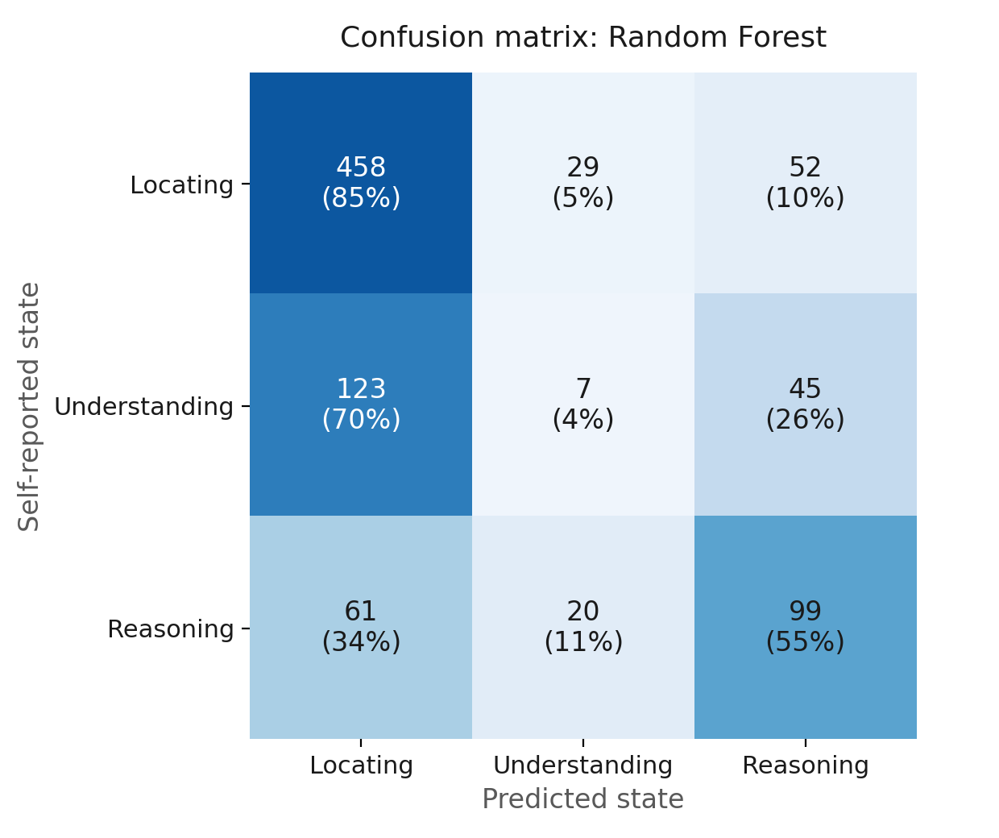
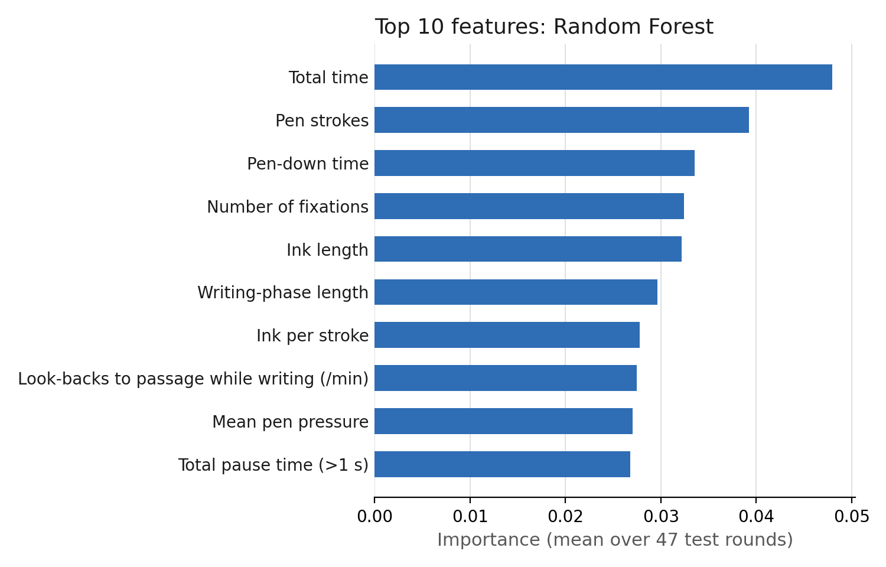

# Detecting learner states from gaze and pen data

This is the code for my graduate research project. I wanted to find out whether you can tell what a student is doing mentally while answering a reading-comprehension question just from where they look and how they write.

I split the task into three states:

- **Locating**: searching the passage for the relevant part
- **Understanding**: working out what a sentence or paragraph means
- **Reasoning**: putting information together and forming an answer

If a tutoring system could recognise these states, it could step in at the right moment, for example by pointing a stuck student to the right paragraph. I recorded eye movements with a Tobii eye tracker and handwriting with a Wacom pen tablet, then trained classifiers on features from both.

## What I did

1. **Built the experiment platform.** A FastAPI server streams Tobii gaze data and receives pen strokes from a browser page where participants read an English passage and write their answers on a canvas. Everything is timestamped so the two streams can be aligned.
2. **Ran the study.** 47 participants answered 894 sub-questions in total. After each sub-question, they reported which state they had mostly been in, and that report is the label.
3. **Checked data quality.** `check_participant.py` runs after every session and marks each sub-question as PASS, WARNING or FATAL (low gaze validity, missing pen pressure, and so on).
4. **Engineered features.** I computed 94 features per sub-question. On the gaze side these are fixations, saccades (I-VT filter, 30°/s), blinks, pupil size and how it changes, gaze speed and dispersion. On the pen side they are stroke count, writing speed and acceleration, pressure, and the time and distance between strokes. I also used total time on the sub-question.
5. **Trained and evaluated models.** I compared Random Forest, XGBoost and LightGBM, both as a single 3-class model and as a two-stage model. The first stage decides "locating or not", and the second decides "understanding or reasoning". I evaluated with leave-one-participant-out cross-validation so the model is always tested on people it has never seen, and averaged over 5 random seeds.

## Results

Mean over 5 seeds, leave-one-participant-out:

| Setup | Model | Features | Accuracy | Balanced acc. | Macro-F1 | Cohen's κ |
|---|---|:-:|:-:|:-:|:-:|:-:|
| Flat | XGBoost | 49 | 0.631 | 0.513 | 0.509 | 0.314 |
| Flat | LightGBM | 94 | 0.649 | 0.506 | 0.499 | 0.314 |
| Two-stage | LightGBM | 94 | 0.629 | 0.519 | 0.510 | 0.316 |
| Two-stage | Random Forest | 94 | 0.652 | 0.506 | 0.488 | 0.322 |
| Two-stage, gaze only | XGBoost | 61 | 0.604 | 0.497 | 0.487 | 0.282 |
| Two-stage, pen only | XGBoost | 36 | 0.607 | 0.506 | 0.503 | 0.283 |

<p align="center">
  
  
</p>

What I took away from this:

- Locating is easy to recognise (F1 around 0.78). Understanding is much harder: it is the smallest class and often gets mistaken for locating.
- Gaze alone and pen alone do about as well as both together, so the two signals seem to carry much of the same information.
- A simple baseline that predicts the most common state for each question position already reaches a macro-F1 of about 0.51, because the order of questions says a lot. The models do not beat it overall. They are clearly better at catching understanding (F1 0.20 vs. 0.00), and that is the state a tutor would care about most.
- I also tried splitting each sub-question into 30-second windows, but it scored lower (macro-F1 around 0.45).
- Random Forest gave noticeably different results on scikit-learn 1.8 than on 1.6, so I pinned the library versions.

## Repository layout

```
main.py                   FastAPI experiment server (Tobii streaming, pen and UI logging)
public/                   Browser task: passage, questions, answer canvas
check_participant.py      Per-session data quality check
extract_features*.py      Feature extraction (earlier versions)
build_dataset.py          Labels, exclusions, gaze-validity flags
compare_*.py, evaluate_step2.py, best_model_report.py   Earlier model comparisons
analysis_v3/              Final analysis
  extract_features_v3.py    94-feature extraction
  evaluate_v3.py            RF / XGBoost / LightGBM, flat vs. two-stage
  windows_v3.py             30-second window experiment
  results_*.csv             Aggregate results
sync_demo.py, test_tobii_stream.py, pen_*.py   Early hardware tests
```

## Running it

```bash
pip install fastapi uvicorn pydantic pandas numpy scikit-learn==1.6.1 xgboost==2.1.4 lightgbm==4.7.0
pip install tobii-research pynput   # only needed with the eye tracker connected

# Experiment server
export ADMIN_PASSWORD="choose-a-password"   # enables the admin endpoints
uvicorn main:app --reload

# Feature extraction and evaluation (needs the participant data, which is not included)
cd analysis_v3
python3 extract_features_v3.py "<participants data folder>" ../dataset_v2.csv
python3 evaluate_v3.py dataset_v3.csv 5
```

## Data

To protect participants' privacy, the raw recordings and per-participant datasets are not included in this repository. Only the code and aggregate results are here.
