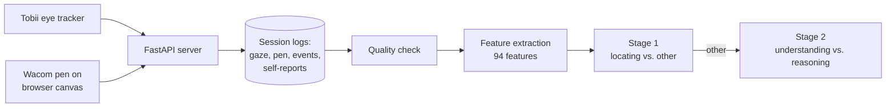
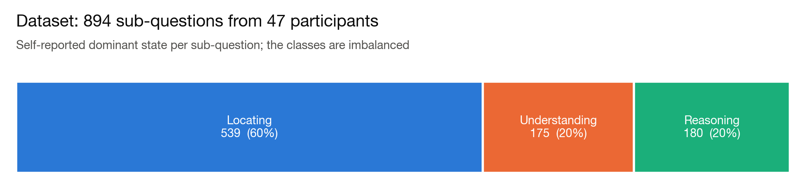
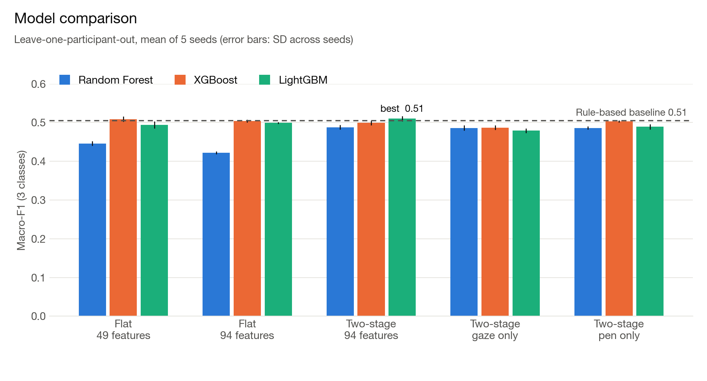
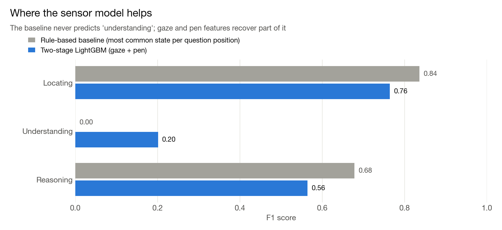
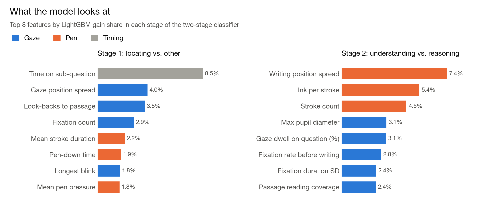

# Detecting learner states from gaze and pen data

This is the code for my graduate research project. I wanted to find out whether you can tell what a student is doing mentally while answering a reading-comprehension question just from where they look and how they write.

**Live demo: [main.d2hz3iy049a24x.amplifyapp.com](https://main.d2hz3iy049a24x.amplifyapp.com)**. Try the reading task from the study in your browser and see the results. It runs entirely client-side: nothing is saved, and no eye tracker is needed (you can write with a mouse or trackpad).

I split the task into three states:

| State | What the student is doing |
|---|---|
| **Locating** | Searching the passage for the relevant part |
| **Understanding** | Working out what a sentence or paragraph means |
| **Reasoning** | Putting information together and forming an answer |

If a tutoring system could recognise these states, it could step in at the right moment, for example by pointing a stuck student to the right paragraph. I recorded eye movements with a Tobii eye tracker and handwriting with a Wacom pen tablet, then trained classifiers on features from both.

**At a glance**

| | |
|---|---|
| Participants | 47 |
| Labelled sub-questions | 894 |
| Sensors | Tobii eye tracker, Wacom pen tablet |
| Features per sub-question | 94 (gaze, pen, timing) |
| Models | Random Forest, XGBoost, LightGBM |
| Evaluation | Leave-one-participant-out, 5 seeds |
| Stack | Python, FastAPI, pandas, scikit-learn, XGBoost, LightGBM, JavaScript (HTML5 canvas) |

## How it works



1. **Built the experiment platform.** A FastAPI server streams Tobii gaze data and receives pen strokes from a browser page where participants read an English passage and write their answers on a canvas. Everything is timestamped so the two streams can be aligned.
2. **Ran the study.** After each sub-question, participants reported which state they had mostly been in, and that report is the label.
3. **Checked data quality.** `check_participant.py` runs after every session and marks each sub-question as PASS, WARNING or FATAL (low gaze validity, missing pen pressure, and so on).
4. **Engineered features.** These are summarised per sub-question (see the table below).
5. **Trained and evaluated models.** Each model is tested on people it has never seen (leave-one-participant-out), with results averaged over 5 random seeds and class weights to handle the imbalance.



### Features

| Group | Examples |
|---|---|
| Gaze | Fixation count and duration, saccades (I-VT filter, 30°/s), blinks, pupil size and rate of change, gaze speed and spread, look-backs from the answer to the passage |
| Pen | Stroke count and duration, writing speed and acceleration, pressure, ink per stroke, pauses, time and distance between strokes |
| Timing | Time spent on the sub-question |

Before computing features, I removed samples near blinks and filtered pupil outliers per participant with the IQR rule.

## Results



| Setup | Model | Features | Accuracy | Balanced acc. | Macro-F1 | Cohen's κ |
|---|---|:-:|:-:|:-:|:-:|:-:|
| Rule-based baseline | – | – | 0.721 | – | 0.505 | 0.42 |
| Flat | XGBoost | 49 | 0.631 | 0.513 | 0.509 | 0.314 |
| Flat | LightGBM | 94 | 0.649 | 0.506 | 0.499 | 0.314 |
| **Two-stage** | **LightGBM** | **94** | 0.629 | **0.519** | **0.510** | 0.316 |
| Two-stage | Random Forest | 94 | 0.652 | 0.506 | 0.488 | 0.322 |
| Two-stage, gaze only | XGBoost | 61 | 0.604 | 0.497 | 0.487 | 0.282 |
| Two-stage, pen only | XGBoost | 36 | 0.607 | 0.506 | 0.503 | 0.283 |

The baseline predicts the most common state for each question position. It is a strong baseline, because the order of the questions says a lot about what students are doing. Overall, the models only match it. Where they help is the state that matters most for a tutor:



The baseline never predicts "understanding", while the sensor model detects part of it. That is the case where a student is struggling with meaning and could use help.



The two stages rely on different signals. Separating locating from the rest depends mostly on time and on how widely the eyes move around the page. Separating understanding from reasoning depends mostly on writing behaviour: how spread out the writing is, how much ink each stroke uses, and the number of strokes.

### Takeaways

- Locating is easy to recognise (F1 around 0.78). Understanding is much harder: it is a minority class and often gets mistaken for locating.
- Gaze alone and pen alone do about as well as both together, so the two signals seem to carry much of the same information.
- Splitting each sub-question into 30-second windows scored lower (macro-F1 around 0.45) than using the whole sub-question.
- Random Forest gave noticeably different results on scikit-learn 1.8 than on 1.6, so I pinned the library versions.

## Repository layout

```
main.py                   FastAPI experiment server (Tobii streaming, pen and UI logging)
public/                   Browser task: passage, questions, answer canvas
check_participant.py      Per-session data quality check
extract_features*.py      Feature extraction (earlier versions)
build_dataset.py          Labels, exclusions, gaze-validity flags
compare_*.py, evaluate_step2.py, best_model_report.py   Earlier model comparisons
analysis_v3/              Final analysis
  extract_features_v3.py    94-feature extraction
  evaluate_v3.py            RF / XGBoost / LightGBM, flat vs. two-stage
  windows_v3.py             30-second window experiment
  results_*.csv             Aggregate results
demo/                     Static public demo (sample passage, no backend), hosted on AWS Amplify
scripts/make_readme_figures.py   Regenerates the charts in this README
sync_demo.py, test_tobii_stream.py, pen_*.py   Early hardware tests
```

## Running it

```bash
pip install fastapi uvicorn pydantic pandas numpy matplotlib scikit-learn==1.6.1 xgboost==2.1.4 lightgbm==4.7.0
pip install tobii-research pynput   # only needed with the eye tracker connected

# Experiment server
export ADMIN_PASSWORD="choose-a-password"   # enables the admin endpoints
uvicorn main:app --reload

# Feature extraction and evaluation (needs the participant data, which is not included)
cd analysis_v3
python3 extract_features_v3.py "<participants data folder>" ../dataset_v2.csv
python3 evaluate_v3.py dataset_v3.csv 5
```

## Data

To protect participants' privacy, the raw recordings and per-participant datasets are not included in this repository. Only the code and aggregate results are here.
